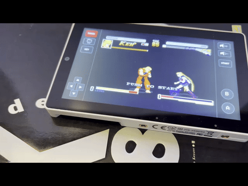
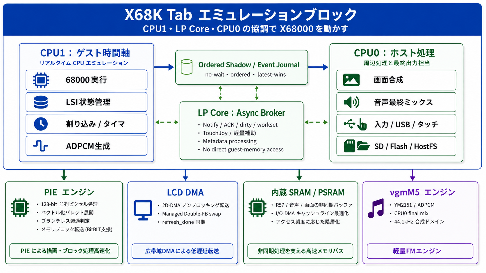

# X68K Tab

[**English README → README_en.md**](README_en.md)

  

  <b>X68000 Emulator for M5Stack Tab5 / ESP32-P4</b> 
  Developed by Layer812 &nbsp;|&nbsp; Based on PX68K &nbsp;|&nbsp; 68000 core: Musashi

## X68K Tab とは

**X68K Tab** は、M5Stack Tab5（ESP32-P4）で動作するポータブル X68000 エミュレータです。

PX68K / Musashi をベースに、ESP32-P4 の 2つの HP CPU、LP Core、PSRAM、MIPI-DSI、USB Host、microSD、内蔵オーディオを活用する構成へ再設計しています。

もともとは、昔の X68000 **PANIC** データを M5Stack Tab5 で再生したくなり、専用プレイヤー [PanicPlayerTab5](https://github.com/Layer812/PanicPlayerTab5) を作ったところから始まりました。

PANIC を再生するために必要な X68000 環境を少しずつ実装していったら...いつの間にか X68000 エミュレータになりました。

---

## Current Production

### 2026-10-28 — R6：M5Unified / M5GFX更新とMDX音声安定化

[変更点・テスト範囲・制約](RELEASE_NOTES_2026-10-28.md)

### 2026-10-25 — YM2151 KEY ON・位相リセット修正（実機初期確認済み）

M2/C1のKEY ON対応と発音開始時の位相リセットを修正しました。実機再生は良好で、現時点でプチノイズは確認されていません。

### 2026-10-25 — YM2151音質・FIR高速化（Tab5実機で初期確認済み）

[vgmM5](https://github.com/Layer812/vgmM5) のR61 FIX1を基準に、位相変調・KF・DT1/DT2、高音域の数値変換を改善しました。YM2151の内部62.5kHz合成＋25タップFIRを追加し、FIRのリング処理をPCM一致のまま高速化しています。最終出力は44.1kHzを維持します。

### 2026-10-09 — PDX / ADPCM 半速再生修正

MDX から PDX / ADPCM を再生した際、特定の再生経路で PCM が本来の約半分の速度になる問題を修正しました。

### 2026-10-05 — Tab5 LCD panel compatibility update

**ST7121 搭載 Tab5 については、表示できなかった実機で X68K Tab が正常に動作することを確認できました。** ST7123 は既知良好個体の安定動作を維持する設定を使用し、ILI9881C 向けの互換設定も含めています。

> **Special thanks to Nochiさん！** ST7121 搭載 Tab5 での実機検証と互換表示対応の確認にご協力いただき、ありがとうございました。

| 項目 | Production 構成 |
| --- | --- |
| Guest CPU | **12 MHz** |
| Peripheral domain | **exact 10 MHz** |
| Guest RAM | **12 MiB** |
| CPU1 | 68000 / guest device time を優先。host-side の都合で待たせない |
| CPU0 | video / LCD / YM2151 / MIDI / final audio mix / USB / storage / host UI |
| Graphics | sparse dirty update |
| Audio | YM2151 + ADPCM |
| Storage | microSD / Flash / HostFS、XDF / DIM / HDS |
| Input | USB Keyboard / Joypad / Mouse + Touch UI |
| MIDI | **YM3802 → MidMod → M5Stack Unit Synth (SAM2695)** |
| GS | **MidMod GS → SAM2695 マッピング** |
| PANIC | Production版では PANIC Player 統合を一旦削除 |

---

## MIDI / MidMod / Unit Synth

今回の更新で、X68000 の MIDI 出力に対応しました。

使用している MIDI 処理ライブラリは、[**MidMod — Modifiable MIDI Module**](https://github.com/Layer812/MidMod) です。

音源は、[**M5Stack Unit Synth (SAM2695)**](https://www.switch-science.com/products/9510) を使用します。

X68K Tab 側では `/sdcard/midimap.csv` を置くことで、マッピングプロファイルを差し替えることもできます。

---

## まず試す — M5Burner

- [M5Burner 公式ページ](https://docs.m5stack.com/en/uiflow/m5burner/intro)
- [M5Stack ダウンロード](https://docs.m5stack.com/en/download)

M5Burner の **Share Burn** で Share Code を入力してください。

| バージョン | Share Code | 用途 |
| --- | --- | --- |
| **2026.10.28 — R6 最新Share Code** | `8i9Cp1C6ufGpGC5J` | **M5Unified / M5GFX更新、MDX再生モタツキ改善（R6実機確認済み・コードは開発者提供）** |
| 2026.10.25 — 従来版 | `wOuCl6ZAtFxUpdy6` | YM2151 KEY ON・位相リセット修正（実機初期確認済み） |
| 2026.10.25 — 従来版 | `2cODB4oLECo97g0u` | YM2151 R61音質改善 + FIR高速化 |
| **2026-10-09 — 従来M5Burner公開版** | `tLkdgjcPoEoGbGEt` | **PDX / ADPCM 半速修正 + Tab5 LCD互換 + MidMod / SAM2695 MIDI** |

**R6のShare Codeは `8i9Cp1C6ufGpGC5J` です。** 開発者から提供された値であり、M5Burner上の配布BINとGitHub ActionsのR6 BINとのハッシュ一致は独立検証していません。その他は従来版のコードです。

---

## 必要なもの

- [M5Stack Tab5](https://docs.m5stack.com/en/core/Tab5)
- microSD カード
- 利用できる X68000 ソフトウェア / ディスクイメージ
  - FDD: `XDF`, `DIM`
  - HDD: `HDS`

### MIDIを使う場合

- [M5Stack Unit Synth (SAM2695)](https://www.switch-science.com/products/9510)

### 入力機器

- [M5Stack Tab5用キーボード](https://www.switch-science.com/products/11257)
- USB キーボード
- USB Joypad / Gamepad
- USB マウス
- 画面上のタッチ UI / バーチャルキーボード / Joypad

---

## ESP32-P4 マルチコア構成

  

- **HP CPU1 — Guest Time Domain**  
  68000、割り込み、タイマ、guest-side DMA、CRTC、audio event など X68000 側の時間を優先して進めます。

- **HP CPU0 — Host Processing**  
  画面合成、LCD、YM2151、MIDI、final audio mix、USB、SD / Flash / HostFS、Touch UI を担当します。

- **LP Core — Lightweight Broker**  
  一部の軽量 notification / metadata / broker 処理を補助します。

中心となる原則は、**host-side の一時的な遅れを理由に CPU1 の guest timeline を不必要に止めないこと**です。

---

## ROM / CGROM / Human68k

本リポジトリには、SHARP X68000 のオリジナル ROM dump、Human68k のディスクイメージ、ユーザー所有の X68000 ソフトウェアを含めません。

CGROM については、オリジナル CGROM dump を再配布するのではなく、`build_cgrom.py` を用意しています。

Human68k 関連ファイルについても、適用される条件に従って各自で正当に用意してください。

詳細:

- `LICENSE_SHARP_X68000.txt`
- `LICENSE_PANIC_X.txt`
- `PANIC_V1.38_NOTICE.txt`
- `THIRD_PARTY_NOTICES.md`

---

## Credits / License

X68K Tab は、多くのエミュレータ、ハードウェア研究、OSS の成果の上に成り立っています。

- PX68K
- Musashi
- vgmM5
- [MidMod](https://github.com/Layer812/MidMod)
- M5Stack / M5Unified / M5GFX
- Espressif ESP32-P4 / ESP-IDF

各ライセンス・third-party notice はリポジトリ内の文書を確認してください。

X68K Tab は個人による非公式プロジェクトです。SHARP、M5Stack その他各権利者の公式・公認・スポンサー製品ではありません。
